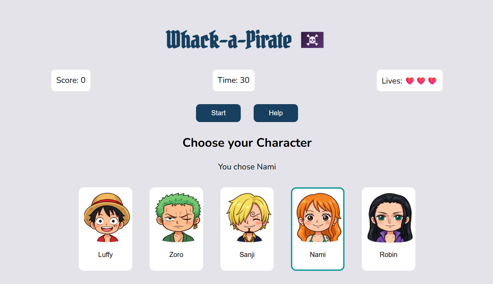
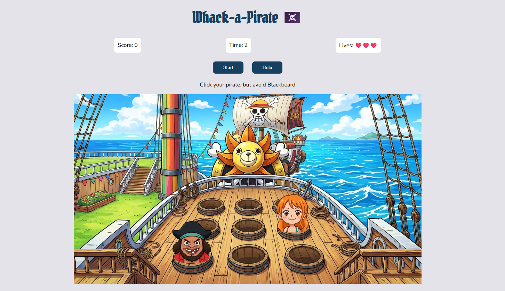
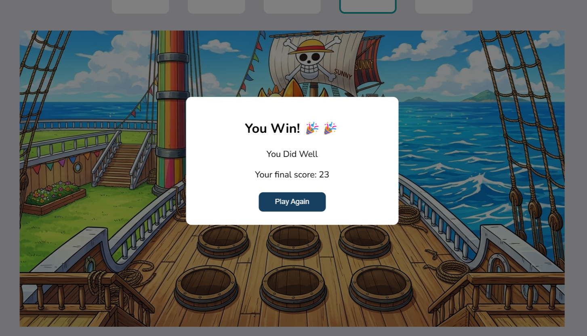

# Whack-a-Pirate🏴‍☠️

## Technologies Used

- HTML
- CSS
- JavaScript

## Description

Whack-a-Pirate is a fun browser game based on the classic _Whack-a-Mole_ game, but with a One Piece anime theme.

The player chooses a character from One Piece and tries to get as many points as possible in 30 seconds.

The chosen character and Blackbeard appear randomly from barrels on the ship. Click your character to get points, but avoid Blackbeard because clicking him will make you lose a heart.

The game ends when the time runs out or the player loses all 3 hearts.

## User Stories

- As a player, I want to choose my favorite character before starting the game.
- As a player, I want to earn points by clicking my character.
- As a player, I want to avoid Blackbeard so I don't lose hearts.
- As a player, I want to see my score and remaining time.
- As a player, I want to see my final score when the game ends.
- As a player, I want to play again with a different character.

## How to Play

1. Choose your character.
2. Click **Start** to begin.
3. Click your character to get points.
4. Avoid Blackbeard to keep your hearts.
5. Try to get the highest score before time runs out.
6. Click **Help** if you need to see the instructions.
7. Click **Play Again** to choose a character and play again.

## Features

- Choose from 5 One Piece characters.
- Random character positions on the ship.
- Score counter.
- 30-second timer.
- 3 hearts.
- Game Over message with the final score.
- Help button.
- Play Again button.

## Screenshots

## Future Enhancements

- Add more One Piece characters.
- Add sound effects.
- Add different difficulty levels.

## Credits

- Developed by: Nawraa Ahmed
- Course Instructor: Omar Kamal
- Associate Instructor: Ayah Meftah
